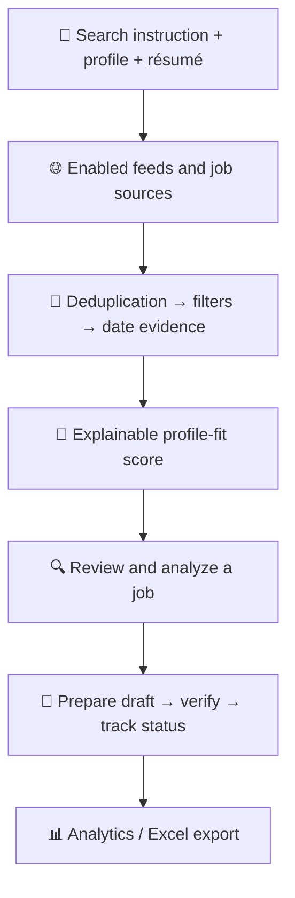

<div align="center">

  

  <br />

  # 🎯 AI Job Hunter

  ### Find better-fit opportunities. Prepare thoughtfully. Track every application.

  An open-source, **local-first** job discovery and application assistant.<br />
  Your résumé, your data, your machine, your decisions.

  <br />

  [](https://github.com/Insideofcub/ai-job-hunter/releases/tag/v0.6.3)
  [](LICENSE)
  [](https://github.com/Insideofcub/ai-job-hunter/actions/workflows/ci.yml)
  

  
  
  
  
  

  <br />

  [**Quick start**](#-quick-start-windows) ·
  [**Features**](#-features) ·
  [**How it works**](#-how-it-works) ·
  [**Privacy & safety**](#-privacy--safety) ·
  [**Docs**](#-documentation) ·
  [**Roadmap**](#-roadmap)

</div>

---

## 📑 Table of contents

<details>
<summary>Click to expand</summary>

- [Why AI Job Hunter](#-why-ai-job-hunter)
- [Features](#-features)
- [How it works](#-how-it-works)
- [Quick start (Windows)](#-quick-start-windows)
- [Configure AI](#-configure-ai)
- [Typical workflow](#-typical-workflow)
- [Privacy & safety](#-privacy--safety)
- [Job-source coverage & accuracy](#-job-source-coverage--accuracy)
- [Project structure](#-project-structure)
- [Development & validation](#-development--validation)
- [Troubleshooting & FAQ](#-troubleshooting--faq)
- [Documentation](#-documentation)
- [Roadmap](#-roadmap)
- [Contributing](#-contributing)
- [License & artwork](#-license--artwork)

</details>

---

## ✨ Why AI Job Hunter

Job searching usually means a dozen browser tabs, a messy spreadsheet, and a lot of copy-pasting. **AI Job Hunter** brings discovery, résumé-to-role comparison, application preparation, and tracking into **one calm, local workspace**.

It combines public job feeds and configured company boards with optional indexed-web research, then helps you review opportunities and keep every application detail organized.

> **Built for review and control, not blind automation.**
> Match scores are estimates. Generated answers are drafts. Posting dates are only called "verified" when there is real evidence. Application submission is **off by default**.

| | |
|---|---|
| 🔒 **Local-first** | Your résumé, profile, and history live on your machine, not on someone else's server. |
| 🔍 **Transparent** | Match scores are explainable, and source and date-evidence labels are always visible. |
| 🧑‍⚖️ **You stay in charge** | Every AI draft must be reviewed. Nothing is submitted for you unless you explicitly enable it. |
| 🧩 **Flexible AI** | Run fully local with Ollama, or plug in an OpenAI-compatible provider. |

---

## 🚀 Features

<table>
  <tr>
    <td width="50%" valign="top">
      <h3>🔎 Multi-source discovery</h3>
      Search enabled public feeds and configured Greenhouse/Lever boards. Optional connectors can broaden discovery when credentials, dependencies, and provider terms permit.
    </td>
    <td width="50%" valign="top">
      <h3>🎯 Explainable matching</h3>
      Compare role relevance, skills, experience, location, and work arrangement. Optional Ollama embeddings add a semantic signal when available.
    </td>
  </tr>
  <tr>
    <td valign="top">
      <h3>🧭 Filters & diagnostics</h3>
      Filter by region, work arrangement, employment type, and posting window. Review source status and see <em>why</em> results were excluded.
    </td>
    <td valign="top">
      <h3>📝 Application preparation</h3>
      Analyze a saved job against your profile and draft screening answers. Review and verify every answer before it is used.
    </td>
  </tr>
  <tr>
    <td valign="top">
      <h3>📋 Queue & history</h3>
      Prepare selected jobs, track statuses, reduce duplicate records, and keep original job links together with your notes.
    </td>
    <td valign="top">
      <h3>📊 Analytics & Excel export</h3>
      Review application status at a glance and export workbook sheets for analytics, applications, and screening answers.
    </td>
  </tr>
  <tr>
    <td valign="top">
      <h3>🧠 Local AI option</h3>
      Use Ollama for local text generation and semantic embeddings. OpenAI-compatible providers are optional alternatives.
    </td>
    <td valign="top">
      <h3>🪟 One-command Windows setup</h3>
      Included PowerShell scripts install dependencies, build the frontend, and start both services for you.
    </td>
  </tr>
</table>

<!--
  📸 SCREENSHOTS (recommended for a premium first impression)
  Add 3 to 4 screenshots to docs/images/ and uncomment the block below.

<div align="center">
  
  
  
  
</div>
-->

---

## 🧠 How it works



<details>
<summary>Plain-text version</summary>

```text
Search instruction + profile + résumé
                  │
                  ▼
     Enabled feeds and job sources
                  │
                  ▼
 Deduplication → filters → date evidence
                  │
                  ▼
      Explainable profile-fit score
                  │
                  ▼
       Review and analyze a job
                  │
                  ▼
   Prepare draft → verify → track status
                  │
                  ▼
          Analytics / Excel export
```

</details>

---

## ⚡ Quick start (Windows)

### Requirements

| Requirement | Version | Notes |
|---|---|---|
| Windows | 10 / 11 | |
| Python | 3.11+ | The current tested setup uses Python 3.12 |
| Node.js + npm | Node 20+ | |
| Git | any recent | |
| [Ollama](https://ollama.com/) | optional | For local AI features |

### 1️⃣ Get the project

```powershell
git clone https://github.com/Insideofcub/ai-job-hunter.git
cd ai-job-hunter
```

### 2️⃣ Run the setup script

```powershell
Set-ExecutionPolicy -Scope Process -ExecutionPolicy Bypass
.\scripts\setup_windows.ps1
```

The script prepares the backend environment, installs frontend dependencies from the lockfile, and runs a production build. It is designed to **preserve your existing `.env` files and local data**.

### 3️⃣ Start the app

```powershell
.\scripts\start_windows.ps1
```

The launcher starts the backend and frontend in separate PowerShell windows and opens the app in your browser.

| Service | Local URL |
|---|---|
| 🖥️ Web app | [http://127.0.0.1:5173](http://127.0.0.1:5173) |
| ❤️ API health | [http://127.0.0.1:8000/api/health](http://127.0.0.1:8000/api/health) |
| 📚 API documentation | [http://127.0.0.1:8000/docs](http://127.0.0.1:8000/docs) |

> 💡 Need help? See the [Windows Quick Start](docs/windows-quick-start.md) for detailed setup and troubleshooting.

---

## 🤖 Configure AI

### Local Ollama (default example)

Install and run Ollama, then pull the example models for local generation and semantic matching:

```powershell
ollama pull qwen2.5:3b-instruct
ollama pull nomic-embed-text
```

Relevant settings in `backend/.env`:

```dotenv
AI_PROVIDER=ollama
OLLAMA_BASE_URL=http://localhost:11434
OLLAMA_MODEL=qwen2.5:3b-instruct
SEMANTIC_MATCHING_ENABLED=true
OLLAMA_EMBEDDING_MODEL=nomic-embed-text
```

### Optional cloud and search providers

| Provider | Purpose | Settings |
|---|---|---|
| **OpenAI-compatible** | Alternative AI provider | `AI_PROVIDER`, `OPENAI_BASE_URL`, `OPENAI_MODEL`, `OPENAI_API_KEY` |
| **Brave Search** | Optional broad indexed-web research | `BRAVE_SEARCH_API_KEY` |
| **Adzuna** | Additional job connector | `ADZUNA_APP_ID`, `ADZUNA_APP_KEY` |
| **JobSpy** | Optional, disabled by default | Install its extra requirements and review each target site's terms before enabling |

> ⚠️ **Never commit `.env` files or expose API keys** in issues, screenshots, logs, or pull requests.
> In cloud AI mode, résumé/profile excerpts used for drafting may be sent to the configured provider. Review its privacy and retention terms first.

---

## 🧭 Typical workflow

1. **Set up your profile**: complete it and upload the résumé you intend to use.
2. **Search**: enter target job titles, location, work arrangement, and employment type.
3. **Check the evidence**: review source and date-evidence labels. Treat unverified dates as *unverified*, not as fresh postings.
4. **Compare**: match a job against your résumé and examine the skills evidence and gaps.
5. **Prepare**: create an application record and draft screening answers.
6. **Verify**: edit each draft and mark it reviewed only when it is accurate.
7. **Apply**: apply manually, or use supported browser form filling where permitted.
8. **Track**: follow progress in Application History and export a workbook when needed.

---

## 🔐 Privacy & safety

AI Job Hunter is designed as a **single-user, local-first application**. Local data may include:

| Data | Location |
|---|---|
| SQLite database | `backend/ai_job_hunter.db` |
| Résumés and uploads | `backend/data/resumes/` and `backend/data/` |
| Browser session profile | `backend/data/browser-profile/` |
| Environment configuration | `.env` files |

These files can contain sensitive personal information, session data, or credentials. **Keep them private and never commit them to GitHub.** The release checks help catch common mistakes but do not replace manually reviewing staged files and scanning for secrets.

### 🛡️ Application automation is guarded

- `AUTO_SUBMIT_ENABLED=false` is the default in the sample configuration.
- Queue preparation creates or reuses draft/history records; it **does not submit** applications.
- Browser form filling is restricted to supported Greenhouse/Lever-hosted flows.
- Human verification, unsupported sites, unresolved required fields, and CAPTCHA or similar checks require manual action.
- Do not bypass CAPTCHA, MFA, identity checks, anti-bot controls, access restrictions, or site terms.
- Never let AI invent work authorization, salary, experience, conflict declarations, or other candidate facts.
- A click without clear confirmation from the employer site must not be treated as a confirmed submission.

### 🚫 Not a public multi-user service

Do not expose the development server directly to the public internet. Before offering a hosted multi-user service, add authentication, authorization, per-user data isolation, secure file access, database migrations, rate limits, and production-grade secrets management.

To report a vulnerability, see the [Security policy](SECURITY.md).

---

## 🌍 Job-source coverage & accuracy

Available results depend on the sources you configure, API access, provider indexing, location coverage, and whether original job pages are accessible. **No universal API provides complete access to every job site.**

| Source type | Notes |
|---|---|
| **Greenhouse / Lever** | Company boards can be configured directly |
| **Public feeds** | Sources such as Arbeitnow, Remote OK, Jobicy, and Himalayas; feed behaviour can change |
| **Adzuna** | Requires credentials |
| **Brave** | Search-index discovery, not a private or authenticated portal API |
| **LinkedIn, Naukri, Indeed, others** | May appear as indexed public leads when available; no guarantee of complete coverage or submission support |

**Accuracy notes**

- Match scores are estimates to help prioritize review, not predictions of hiring outcomes.
- Original posting dates are considered verified only when the source provides adequate evidence. A search result's age is not proof of a posting's original date.
- Check each source's current terms before enabling a connector, and pause a source if it reports access restrictions or rate limits.

---

## 🗂️ Project structure

```text
ai-job-hunter/
├── backend/            # API, job-source connectors, matching, local database
│   ├── app/
│   ├── data/           # Local uploads and browser profile (never commit)
│   └── .env            # Local configuration (never commit)
├── frontend/           # Web interface
│   └── public/
├── scripts/            # Windows setup/launch scripts and release checks
├── docs/               # Guides and workflow documentation
├── SECURITY.md
├── ASSET_NOTICES.md
├── CHANGELOG.md
└── LICENSE
```

---

## 🧪 Development & validation

### Backend tests

From `backend` in PowerShell:

```powershell
$env:PYTHONPATH = "."
.\.venv\Scripts\python.exe -m pytest -q
```

### Release checks

From the repository root:

```powershell
.\backend\.venv\Scripts\python.exe scripts\preflight.py
.\backend\.venv\Scripts\python.exe scripts\validate_release.py --root .
.\backend\.venv\Scripts\python.exe scripts\check_release.py --root .
.\backend\.venv\Scripts\python.exe -m compileall -q backend\app backend\run_server.py scripts
```

### Frontend production build

```powershell
cd frontend
npm ci --no-audit --no-fund
npm run build
```

> For a public release, also inspect Git status, staged diffs, secret-scanning findings, provider/site terms, and the asset notices. Automated validators cannot guarantee that a repository contains no confidential information.

---

## 🩺 Troubleshooting & FAQ

<details>
<summary><strong>PowerShell blocks the setup script</strong></summary>

Run this in the same window first, then re-run the script. It only affects the current session:

```powershell
Set-ExecutionPolicy -Scope Process -ExecutionPolicy Bypass
```

</details>

<details>
<summary><strong>The web app opens but shows no results</strong></summary>

Check that the API is running at [http://127.0.0.1:8000/api/health](http://127.0.0.1:8000/api/health), then review the source status and exclusion diagnostics in the app. Some sources may be paused, rate-limited, or missing credentials.

</details>

<details>
<summary><strong>AI drafts or semantic matching do not work</strong></summary>

Confirm Ollama is running, that the models in `backend/.env` have been pulled, and that `OLLAMA_BASE_URL` is correct. If you use a cloud provider instead, confirm `AI_PROVIDER` and the matching key and base URL are set.

</details>

<details>
<summary><strong>Does it apply to jobs automatically?</strong></summary>

No. Auto-submit is disabled by default, and queue preparation only creates drafts and history records. Supported browser form filling is limited to certain Greenhouse/Lever flows and never bypasses human verification.

</details>

<details>
<summary><strong>Is my résumé sent anywhere?</strong></summary>

With local Ollama, processing stays on your machine. If you configure a cloud AI provider, résumé/profile excerpts used for drafting may be sent to that provider, so review its terms first.

</details>

<details>
<summary><strong>Does it work on macOS or Linux?</strong></summary>

The included setup and launch scripts target Windows. The backend and frontend are standard Python and Node.js projects, but macOS/Linux setup is not officially documented yet. See the [Roadmap](#-roadmap).

</details>

---

## 📚 Documentation

| Guide | What's inside |
|---|---|
| [Windows Quick Start](docs/windows-quick-start.md) | Detailed setup and troubleshooting |
| [Simple search-to-apply workflow](docs/simple-search-to-apply.md) | The end-to-end path |
| [Multi-portal search](docs/multi-portal-search.md) | How sources are combined |
| [Location and work filters](docs/location-and-work-filters.md) | Region and arrangement filtering |
| [Semantic matching](docs/semantic-matching.md) | Embeddings and scoring |
| [Application queue](docs/application-queue.md) | Preparing and tracking applications |
| [Job analysis and preparation](docs/job-analysis-and-preparation.md) | Fit analysis and drafts |
| [Release hardening](docs/release-hardening.md) | Pre-release safeguards |
| [Public release checklist](docs/public-release-checklist.md) | Final checks before publishing |
| [Security policy](SECURITY.md) | Reporting vulnerabilities |
| [Asset notices](ASSET_NOTICES.md) | Artwork origin and rights |
| [Changelog](CHANGELOG.md) | Version history |

---

## 🗺️ Roadmap

- [ ] Improve match-score calibration using user-reviewed outcomes
- [ ] Expand permitted source adapters and keep validating supported application flows
- [ ] Improve the Windows first-run experience and troubleshooting
- [ ] Scheduled searches and richer reminders
- [ ] Authentication, multi-user isolation, migrations, and cloud hardening before any hosted deployment

Have an idea? [Open an issue](https://github.com/Insideofcub/ai-job-hunter/issues) and tell us what would make your search easier.

---

## 🤝 Contributing

Issues, bug reports, documentation improvements, and pull requests are welcome. Please read [CONTRIBUTING.md](CONTRIBUTING.md) first.

**Please never include** private résumés, application exports, credentials, browser data, or personal information in issues, pull requests, or test fixtures.

If AI Job Hunter helps your search, consider giving the repo a ⭐. It helps others find it.

---

## 📄 License & artwork

The source code is licensed under the [MIT License](LICENSE).

The bundled neon background was generated using Google Gemini. See [ASSET_NOTICES.md](ASSET_NOTICES.md) for the project's stated origin and the distinction between source-code licensing and artwork rights. The MIT license for the source code does not automatically grant rights to third-party or separately licensed assets.

---

<div align="center">

  **Built to make job hunting more organized, transparent, and reviewable.**

  [View the repository](https://github.com/Insideofcub/ai-job-hunter) ·
  [Explore releases](https://github.com/Insideofcub/ai-job-hunter/releases) ·
  [Report an issue](https://github.com/Insideofcub/ai-job-hunter/issues)

</div>
